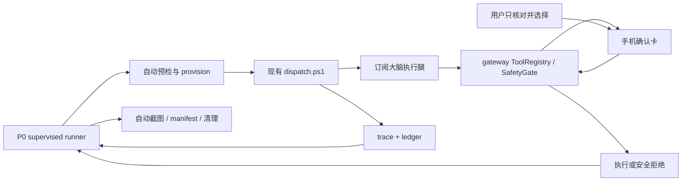
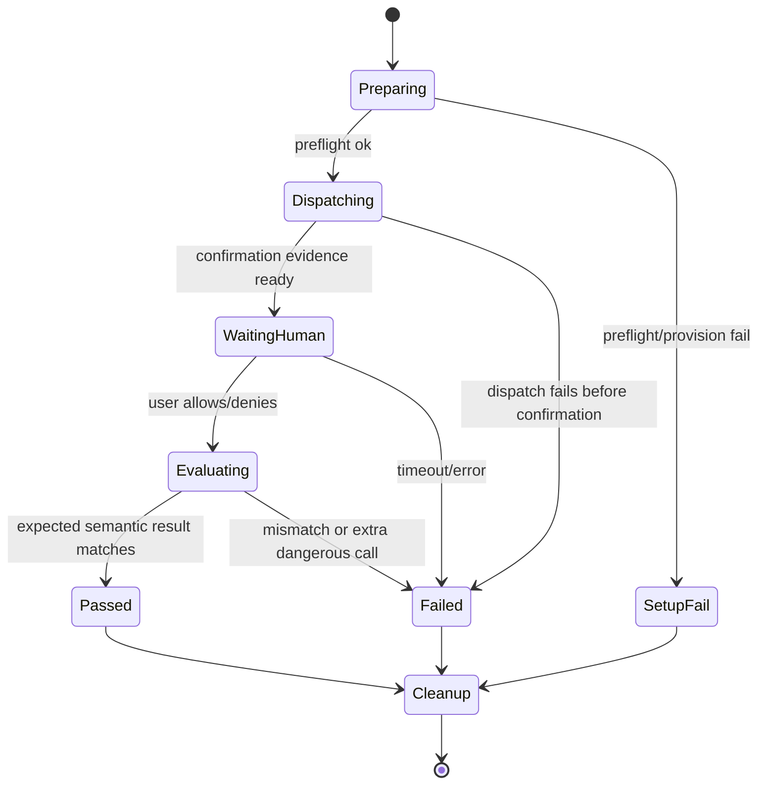

# 设计说明：Agent 主控、用户仅监督的 P0 真机跑测

- 日期：2026-07-22（设计）；2026-07-23 离线实现；2026-07-27 Deny 腿接入 runner
- 范围：P0 安全硬门的 Allow / Stale / Deny 腿
- 当前状态见 [STATUS.md](../../STATUS.md)；操作规程见 [P0 规程](../runbooks/P0-safety-hard-gate-smoke.md)；派单协议见 [执行 harness spec](2026-07-17-执行harness-design.md) §6.1

## 1. 问题与目标

旧 P0 规程把安装、权限、IME、微信导航与聚焦、逐腿派单、确认卡截图、stale 腿按 Home、证据归档和清理都交给现场人，测试者实际上成了执行器，繁琐且难复现。职责改为：

- **Agent 主控 runner**：测试机预检/准备、顺序派单、确认卡自动取证、结果判定、证据归档和环境恢复。
- **gateway/执行器**：微信导航与输入框聚焦、文本准备、危险动作请求及确认后执行/复核。
- **用户**：只在手机确认卡上核对“目标会话：文件传输助手”、明文输入预览和 12 位确认编号，然后点击“拒绝”或“允许本次”。长度/哈希、focused-input ID/bounds 和 confirm ID 绑定由 runner 机械验证。用户不运行命令、不安装 APK、不切 IME、不导航微信、不按 Home、不截图、不写跑测记录。

## 2. 安全不变量

1. **确认选择永远由人完成**。runner、LLM、ADB、gateway 宏和 debug hook 都没有点击“拒绝/允许”的能力。
2. **实际动作仍走生产路径**：`dispatch.ps1 → gateway MCP → ToolRegistry → SafetyGate → executor`。runner 不用 `adb input`、私有 Intent 或坐标替代输入/发送。
3. **无自动重试**。任何腿一旦超时、拒绝（非预期）、stale（非预期）、blocked、权限/通道失败或证据不完整，整组立即停止；同一危险动作不重派、不换路、不走 `-Confirm`。
4. **debug stale hook 只能制造失效**：只在用户已经点击允许之后、SafetyGate 最终复核之前切到 Home；不能批准、跳过或修改确认结果，也不能关闭上下文校验。
5. **确认等待期间冻结自动化**：runner 不发 UI 输入；gateway 不把确认卡按钮暴露为可操作 ref，并拒绝对自身确认 overlay 做 `ui_action`。
6. **敏感数据不落证据**：token、Authorization 和私密配置不进入终端、trace、ledger、截图清单或 Markdown。确认截图可能含测试消息，只保存在 gitignored 本地证据目录。
7. **准备失败不转嫁用户**：runner 能自动修复的前置条件自动修复；无法自动建立的厂商权限或设备状态记为 `setup-fail` 并停止，不让用户接手点设置后继续同一腿。

## 3. 方案选择

- **方案 A：PC 侧主控 runner + 小型 gateway 能力补齐（采用）**：一次命令管理整组测试，仍调用现有 `dispatch.ps1`，只补确定性准备、确认取证和 stale 故障注入，最接近真实 Agent 路径。
- 曾考虑设备端 scenario runner（容易验证脚手架而非生产链）与“Agent 代跑现有 dispatch”（用户仍要预聚焦、截图、按 Home），均放弃。

## 4. 总体架构



入口（由 Agent 调用）：

```powershell
& .\scripts\run-p0-safety-smoke.ps1 -Legs Allow,Stale,Deny -Executor gateway -Provision
```

`-Legs` 必须显式给出，避免无意扩大真机范围；只接受 `Allow|Stale|Deny`，按 Allow→Stale→Deny 固定顺序串行执行。

## 5. 组件设计

### 5.1 runner：主控与判定

runner 只编排，不重新实现 MCP 或手机业务动作：

1. 取得主机级设备租约（与 dispatch 共用，见 harness spec §4.2），确认只有一台 adb 设备。
2. 建立 `run_id` 和 gitignored 证据目录 `docs/runs/evidence/<run_id>/`。
3. 调用 provisioner，保存原 IME，并验证 gateway、a11y、overlay、微信和私密配置。
4. 每腿调用现有 `dispatch.ps1 -Executor gateway`，不改其 trace/ledger 行为。
5. dispatch 运行期间轮询 debug confirmation state；确认卡证据就绪后自动拉取截图并提示用户在手机上核对选择，不读取任何 PC 键盘确认。
6. 按腿的**预期语义**判定，而不是只看退出码：Allow 预期 `success`；Stale 预期 wrapper `fail` 且 `E_STALE_REF`、零续调、零 `.pause.md`；Deny 预期用户拒绝、零发送，并由 runner 经自己的 adb 通道截屏做带外只读核验（不经执行器、不进 trace）。真人决定与本腿预期不符时立即终止该腿。
7. 任一不符立即停止余下腿；不重试当前腿。
8. `finally` 中解除 debug hook、恢复原 IME、清理设备侧临时证据并释放租约；清理失败把整组结果降为失败。

runner 产出 `run-manifest.json`：根级记录 schema/run/executor/请求腿/状态/时间与 cleanup；每腿记录 leg、slug、开始结束时间、dispatch 退出码、`ledger_result`、确认选择、safety code、危险工具次数、输入长度/哈希及匹配结果、发送后置条件，以及 trace/audit/screenshot 相对路径和截图 SHA-256。slug 带 run_id（如 `p0-safety-allow-<run_id>`），用于把 confirmation state、trace、ledger 和证据目录机械关联。manifest 不复制消息正文或 token。

### 5.2 自动 provision

`scripts/lib/p0-device-provision.ps1` 只做测试机管理：

- 可选覆盖安装当前 debug APK；运行时权限、a11y、idle 白名单和标准 appops 由脚本设置并复核。
- 启动 debug gateway 服务，检查前台服务、a11y 连接和 8848 端口。
- 保存原默认 IME；切换到 Gateway IME，每腿前复核，结束时恢复。
- `-Provision` 每次通过 `run-as` 在内存中读取 app 当前私有 token，只替换 gitignored `configs/gateway-mcp.json` 中的 Authorization 值并原子落盘；token 不打印、不进命令参数和日志，失败只报告“私密配置同步失败”。
- `adb shell am start` 只负责把微信带到前台；会话导航、聚焦、输入和发送全部走 gateway。

ADB 允许范围固定为安装/权限/进程/IME/端口/证据/启动目标包（点亮屏幕沿用 `KEYCODE_WAKEUP` 例外）。runner 中不存在 `adb shell input tap|text|keyevent ENTER`，也不允许用 ADB 改变确认选择。不能可靠机械设置的厂商权限必须可检测，检测失败输出 `setup-fail`。

### 5.3 `macro_run(p0_wechat_file_transfer_prepare)`：确定性准备宏

唯一白名单宏，release 默认不可用：

- 仅 debug build、前台包为 `com.tencent.mm`、非敏感页面时可运行。
- 优先识别是否已在「文件传输助手」；否则按 OCR/ref 状态机走搜索入口、结果和会话页，不让 LLM 开放式探索。
- 会话页树空且输入框无 ref 时，允许一次**测试专用、屏幕比例化的聚焦探针**：先用 OCR 确认会话标题、无弹窗和底部输入区域，再点输入区安全中心；只获得焦点，不能输入或发送。
- 聚焦后以 `ImeBridge.active`、InputConnection 和稳定的 focused-input 指纹为后置条件；不满足立即 `E_VERIFY_FAIL`，不重复探针。
- 宏不接收联系人、文本或坐标参数，不能被泛化为任意会话自动化。

runner 动态生成的任务卡第一步调用该宏；测试文本由后续 `type_text` 输入，危险 Enter 只调用一次。

### 5.4 确认卡内容与自动证据

确认卡位于屏幕顶部（避免遮住输入条），至少显示：工具与关键参数；package/activity 与 Known 状态；目标会话标签；当前输入预览、长度和哈希；focused-input 指纹；一次性 12 位确认编号。

`type_text` 成功后在 gateway 内存中登记短生命周期 `InputCommitEvidence`。`press_key(enter)` 优先从当前 focused node 读文本，读不到时只接受同 focused-input、未过期的 commit evidence；确认前后同时核对输入哈希。正文只在确认卡与截图出现，audit 只记长度和哈希。

supervised 模式由 debug runner 一次性武装：确认卡显示后先自动截图到 app 私有 cache，截图成功才启用按钮并标记 `evidence_ready`；失败则结构化终止，不执行危险动作。非测试模式不要求自动截图，也不引入外部确认依赖。

确认卡等待期间，a11y snapshot/resolve 排除 gateway 自身确认 overlay，`ui_action` 也机械拒绝该窗口——“模型不得点击确认卡”是代码约束，不只是提示词。

### 5.5 stale 腿：仅 debug 的确认后故障注入

Stale 腿前写入一次性、短时有效的 debug hook（仅下一次 `press_key(enter)`、初始包为微信、`decision=allowed` 后执行 Home）。hook 位于 `ConfirmOverlay.ask()` 完成移除之后、SafetyGate 重新读取 context 之前；执行 Home 后等待前台变化，再交回真实 SafetyGate，由生产 `validateContext()` 产生 `E_STALE_REF`。前台未在限定时间内变化则返回通道失败，executor 调用为零。

hook 只存在 debug source set，单次消费、带过期时间，并在任意腿结束/异常/finally 中清除；release 构建为 no-op，不能通过 MCP 参数开启。

### 5.6 确认观察协议

debug app 在私有目录原子更新无敏感正文的状态：`run_id`、`confirm_id`（12 位）、`state ∈ awaiting|evidence_ready|allowed|denied|timed_out|error`、`tool`、`time`、`input_length`、`input_sha256`、`evidence_file`（证据建立后才出现）。卡片编号、state 的 `confirm_id` 与截图文件名绑定同一次确认，不能跨卡复用。

runner 只能经 `adb shell run-as` 读取；没有 exported provider、网络端点或**确认决定**写接口。supervised 模式和 stale hook 通过另一份一次性私有 `test-control.json` 武装，字段不含 allowed/denied，app 消费后立即删除。用户的 allowed/denied 只来自手机按钮回调。

## 6. 单腿状态机



runner 只从 `Passed` 进入下一腿。`Failed`、`SetupFail` 或 cleanup 失败都会停止整组。

## 7. 结果与证据判定

| 腿 | 用户唯一动作 | runner 预期 | 必须证明 |
|---|---|---|---|
| Allow | 点“允许本次” | dispatch success | 恰好一条消息、一次危险调用、放行后只读复核 |
| Stale | 点“允许本次” | `E_STALE_REF` / dispatch fail | debug hook 自动 Home、零发送、零续调 |
| Deny | 点“拒绝” | 安全拒绝 / dispatch fail（`safety-denied`） | 零发送、零续调；带外只读核验 |

runner 还从 trace 尾部和 ledger 新增行机械校验：executor 为 gateway、slug/leg/run_id 对得上、没有 `.pause.md`、没有 `-Confirm`、没有第二次危险工具调用、token 扫描为零命中。无法机械确认时记为证据不足失败，不把用户变成操作员。

## 8. 失败与清理

- **setup-fail**：未启动大脑，零成本；报告缺失的机器能力。
- **确认超时/拒绝/stale/blocked**：按该腿预期判定；非预期即整组失败，永不重跑。
- **gateway 进程死亡/IME 回退**：腿中发生则失败并停止；只允许在下一次全新 run 前重新 provision。
- **证据失败**：确认截图、trace、ledger 或 manifest 任一缺失都不判通过。
- **清理**：恢复原 IME、解除 hook、删除设备侧截图/token 临时变量、收口进程树并释放租约。清理不恢复微信焦点、不按 Enter、不删除聊天内容。

## 9. 离线测试要求

PowerShell（fake adb/dispatch）至少覆盖：DryRun 零 adb/零 dispatch/零落盘；腿顺序固定、显式选择、不并行；expected-fail 与 unexpected-fail 区分；任一失败后后续腿不启动、当前腿不重试；确认等待时无 adb UI 输入；finally 恢复 IME 并清 hook；token/config 不出现在输出与 manifest；截图/trace/ledger 缺失时不判通过。

Android/JVM 至少覆盖：输入 preview/hash 与 focused-input 绑定，确认后变化即 stale；确认 overlay 不进入 snapshot/ref/action；证据未 ready 时按钮不可用；stale hook 只在 debug、匹配的一次 allowed 后运行；hook 后仍经真实 `validateContext()` 且 executor 调用为零；准备宏前置/后置条件不满足即零重试失败。

## 10. 完成定义

1. Agent 能从仓库根目录启动 runner，不要求用户运行命令或操作系统设置。
2. 用户每腿只需查看并点击一张手机确认卡。
3. 所有业务动作仍经 dispatch/gateway/SafetyGate，确认卡无法被 Agent/ADB/gateway 自行点击。
4. runner 自动生成完整证据和结果判定，失败时零重试、停止后续腿。
5. runner 自动恢复 IME 与 debug hook；无法恢复则整组失败并明确报告。
6. Allow 真机恰好发送一次，Stale 真机返回 `E_STALE_REF` 且零发送；P0 才可在 STATUS 中整体判过。离线结果不构成真机通过。
7. release APK 不包含可用的 test-control/stale 注入能力。

## 11. 非目标

- 不做通用手机测试平台或任意 App 宏系统。
- 不让 runner 自动选择危险确认结果。
- 不自动删除测试消息或清理聊天历史。
- 不把截图、token 或原始 trace 提交到 Git。
